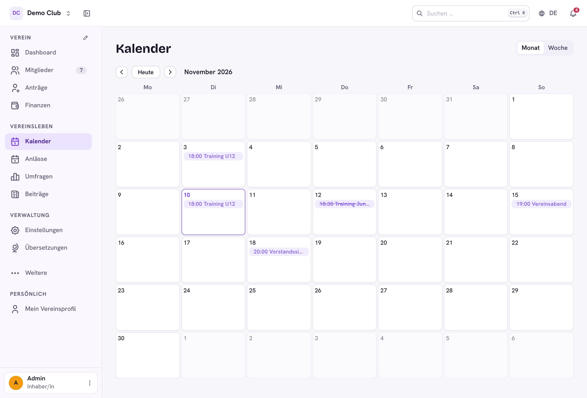
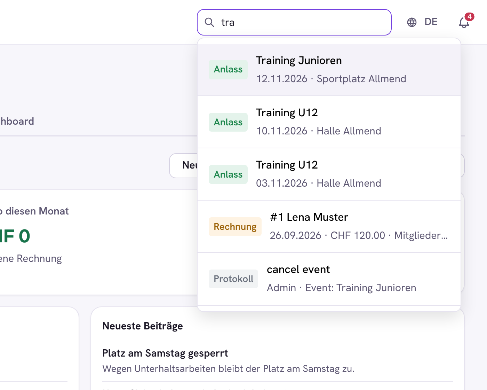
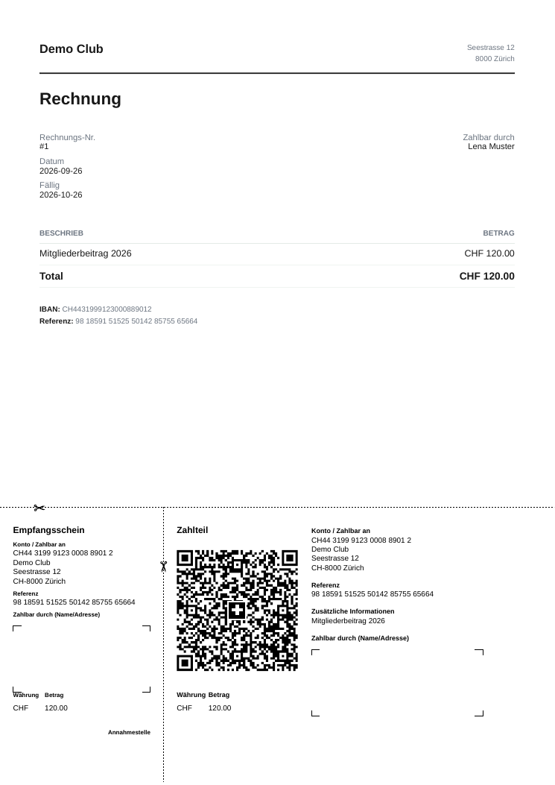
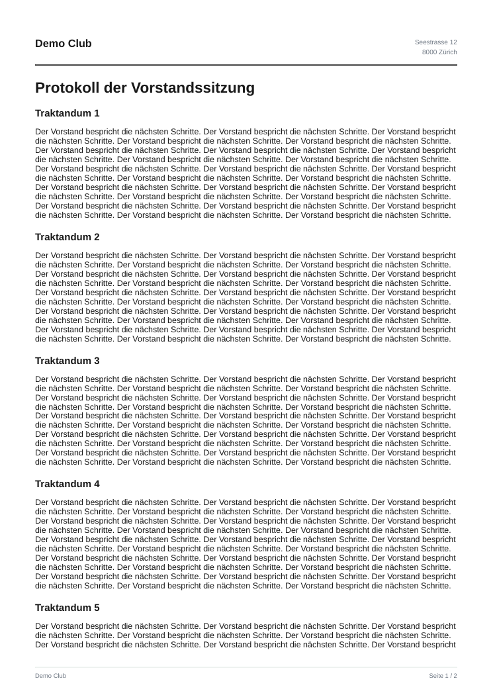

# Contracts: how modules and plugins use each other

A plugin never imports another plugin, reads its tables or calls its REST
routes from the backend. Instead each module offers **contracts** by name
and version, and others use them through core:

| Kind | What it is | How others use it | Reply |
| --- | --- | --- | --- |
| event | a fact (`booking.confirmed`) | subscribe with `Module.events` | none; zero or more listeners |
| action | a command with one owner (`keys.key.hand_out`) | `call()` now, or `send()` after the commit | the action's result |
| query | a read (`inventory.items.get`) | `query()` | the result; writes are rolled back |
| widget | a dashboard widget (`inventory.lent`) | members add it to dashboards | what it shows, read as the viewer |

Core finds who offers a contract, checks that its module is on for the club,
checks the acting member's right, checks the input and the result against
the contract's schema, and keeps a failing handler's work away from the
caller's. The code is in `app/backend/hubra/core/contracts/`.

## Offering

```python
# hubra_inventory/__init__.py
from hubra.core.contracts import event_contract, query_contract
from hubra.core.modules import Module

module = Module(
    code="inventory",
    name="Inventory",
    provides=(
        query_contract(
            "inventory.items.get",
            "hubra_inventory.contracts:get_items",
            input="hubra_inventory.contracts:ItemsIn",
            output="hubra_inventory.contracts:Item",
            perm="inventory.items.read",
        ),
        event_contract("inventory.item.deleted", "hubra_inventory.contracts:ItemRef"),
    ),
)
```

```python
# hubra_inventory/contracts.py
from pydantic import BaseModel


class ItemsIn(BaseModel):
    ids: list[int]


class Item(BaseModel):
    id: int
    name: str


class ItemRef(BaseModel):
    item_id: int


def get_items(ctx, data: ItemsIn) -> list[Item]:
    rows = InventoryItem.query.filter(InventoryItem.id.in_(data.ids)).all()
    return [Item(id=r.id, name=r.name) for r in rows]
```

Rules (checked when the plugin loads, `core/plugins/limits.py`):

- Names start with the module code: `inventory.items.get`.
- Handlers and schemas are the plugin's own code. Schemas are pydantic
  models, named by dotted path so the manifest loads without them.
- No two modules offer the same name; Hubra's own events are taken.
- `plugin.yaml` lists `contracts` under `uses:`.

A handler gets a `CallContext` (`tenant_id`, `actor`, `system`, `caller`,
`message_id`) and the checked input. It returns a model, a list of models
or plain values. To say no for a reason the caller can show, raise
`Refused("This key is already handed out", code="KEY_TAKEN")`. A handler
must not commit: core does, so its work rolls back alone when it fails.

## Using

```python
# hubra_booking/__init__.py
module = Module(
    code="booking",
    ...,
    consumes={"inventory.items.get": ">=1,<2", "keys.key.hand_out": ">=1,<2"},
    events={"inventory.item.deleted": "hubra_booking.hooks:on_item_deleted"},
)
```

```python
from hubra.core.contracts import (
    SYSTEM, ActionUnavailable, Refused, available, call, query, send,
)

if available("inventory.items.get"):
    items = query("inventory.items.get", ids=[3, 7])  # as the signed-in member

try:
    call("keys.key.hand_out", key_id=12, member_id=5, actor=SYSTEM)
except ActionUnavailable:
    ...  # Keys isn't installed, didn't load, or is off for this club
except Refused as exc:
    ...  # show exc to the person

send("keys.key.hand_out", key_id=12, member_id=5, actor=SYSTEM)  # after the commit, retried
```

- A plugin may only use contracts it lists under `consumes` (and its own);
  anything else raises `ContractError`. The range is checked against the
  offer's version on every use.
- `consumes` doesn't make the other plugin required. To require it, also
  list it under `depends:` in `plugin.yaml`.
- `actor` defaults to the member of the current request. `actor=SYSTEM`
  skips the permission check: use it in jobs, or when the plugin acts on its
  own behalf (a booking hands out a key the member couldn't hand out).
- Errors: `ActionUnavailable`, `ActionForbidden`, `Refused` (with `code`),
  `ActionFailed` (the handler broke; its work was rolled back, yours wasn't)
  and `ContractError` (a bug: bad input, undeclared use).
- A plugin's own events need a contract too: `emit()` refuses a name no
  module lists under `provides` when a plugin sends it.

## Widgets

`widget_contract(name, handler, label=…, size=…, view=…, fields=…, perm=…)`
offers a dashboard widget. Core lists it only to members who may see it
(module on, `perm` held), runs its handler as the viewing member like a
query, and checks the result against its view (`stat`, `list`, or the
contract's `output` for `custom`). See [dashboards.md](dashboards.md).

## Privacy: export and deletion

Core already puts every club row that points at a member through a foreign
key into the member's privacy export, and deletes or anonymises it with the
member (each key's `ondelete`). A module that keeps more about a member
(rows found by email or account, files, data in another service) offers two
contracts named after its module code, made with
`hubra.core.contracts.privacy.privacy_contracts`:

```python
from hubra.core.contracts.privacy import privacy_contracts

provides=(
    *privacy_contracts(
        "documents",
        export="hubra_documents.privacy:export",
        erase="hubra_documents.privacy:erase",
    ),
)
```

| Contract | Kind | In → out | When |
| --- | --- | --- | --- |
| `<module>.privacy.export` | query | `{member_id}` → `{data: {...}}` | every export (manage › data requests, the member's own download, "Alles als ZIP"); lands under `modules.<module>` |
| `<module>.privacy.erase` | action | `{member_id}` → `{rows}` | every permanent deletion (deletion request, the retention job, Endgültig löschen), before core removes the member |

Both run as the system, also while the club has the module switched off:
the data is still there. An export that fails is listed with an `error`
and the rest still exports; an erase that fails stops the whole deletion
(409 `PRIVACY_ERASE_FAILED`), so nothing is half deleted.

## Calendar: one club calendar

**Kalender** in the club app (`/app/calendar`, `GET /api/v1/app/calendar/?start=&end=`)
shows the dated things of every module side by side: events from core,
bookings from Booking, and whatever else a module offers. Each module
offers one query named after its module code, made with
`hubra.core.contracts.calendar.calendar_contract`:

```python
from hubra.core.contracts.calendar import calendar_contract

provides=(
    calendar_contract("booking", "hubra_booking.calendar:items"),
    # perm="...": only members with that right see these items
)
```

| Contract | Kind | In → out |
| --- | --- | --- |
| `<module>.calendar.items` | query | `{start, end}` (dates, both included) → `{items: [{id, title, kind, start, end?, all_day, location?, path?, group_id?, color?, cancelled}]}` |

Times are the club's local time without a zone; an all-day item starts at
midnight of its first day and its `end` is midnight of its last day. `kind`
("event", "booking", "fixture", "duty", ...) drives the filter chips and
colours; `path` is where the club app opens the item. The calendar asks
each module as the viewing member: a module that is off, or whose `perm`
the member lacks, is left out, and one that fails is named under `failed`
while the rest still shows. Ranges are at most 400 days, and a module
answers at most 1000 items per range.

The calendar, search and privacy contracts are the ones whose input and
output are Hubra's own models; a plugin may offer them (the handler stays its own
code).



## Search: one box for the club

The search in the club app's top bar (Ctrl K) asks the server
(`GET /api/v1/app/search/?q=`) and every module answers for itself. Each
module offers one query named after its module code, made with
`hubra.core.contracts.search.search_contract`:

```python
from hubra.core.contracts.search import search_contract

provides=(
    search_contract("inventory", "hubra_inventory.search:hits", perm="inventory.items.read"),
)
```

| Contract | Kind | In → out |
| --- | --- | --- |
| `<module>.search` | query | `{q, limit}` → `{hits: [{id, label, sub?, date?, path, kind}]}`, at most `limit` (≤ 10) |

A hit matches when every word of `q` is somewhere in it, case ignored.
`kind` ("member", "event", "invoice", ...) is the badge in the result list;
`date` is shown in the club's date format before `sub`. The search asks each
module as the viewing member, skips a module that is off or whose `perm`
the member lacks, and names one that fails under `failed`. Hubra itself
offers `members.search` (names, plus email and phone for those who manage
members), `groups.search`, `events.search`, `posts.search`, `polls.search`
and `finance.search` (invoices by number, description or who pays).
Page names, the audit log and plugin lists registered in the browser
(a plugin's `search` list in its frontend) are still searched in the app.



## PDFs: one letterhead

Every PDF a club sends carries the same letterhead
(`hubra/core/services/pdf.py`, template `templates/pdf/base.html`): the
club's logo and name, the address from Finanzen › Bank & QR-Rechnung and
its website at the top of each page; its name, finance contact and
"Seite x / y" at the bottom; headings in its primary colour (Settings ›
Verein). Invoices use it, with the QR-bill slip at the bottom edge of the
first page. A plugin calls `pdf.render` with the body as HTML (it escapes
what members wrote) and gets the PDF back as base64; it never imports core
or WeasyPrint for it. WeasyPrint loads only `data:` URIs, nothing from disk
or the network.




## Versions

`version` is the contract's major version, a whole number. Adding an
optional field keeps it. Removing or renaming a field, or changing what it
means, raises it, and consumers name the versions they accept
(`">=1,<2"`). A consumer whose range isn't met gets `ActionUnavailable`;
an event subscriber whose range isn't met isn't called (logged).

## Delivery: the outbox

A plugin's event handlers and every `send()` go through the
`contract_outbox` table (public schema, one row per delivery):

1. The row is written in the caller's transaction. Rolled back, it's gone.
2. After the commit the transport hands it to the worker
   (`hubra.core.tasks.contract_tasks.deliver`).
3. The worker claims the row for 5 minutes, runs the handler in the club
   and marks it `done`. A failure is retried after 30 s, 2 min, 10 min,
   1 h and 6 h, then the row is `dead`. `Refused`, `ActionForbidden`,
   `ActionUnavailable` and `ContractError` are not retried.
4. Every minute the sweep (`contract_tasks.sweep`) sends what is due again:
   retries, rows whose worker died, rows the transport lost because Redis
   was down at the commit. A new row is left to its own delivery for
   2 minutes first, so a busy queue doesn't get a second copy of every row.
   Done rows are kept 7 days, dead ones 30.
5. A delivery is stopped after 4 minutes (inside the 5 minute claim), so a
   row is never run by two workers at once. Keep handlers short; queue
   longer work as a job of your own.
6. A row that gives up after every retry, or fails with `ContractError`,
   raises a system alert (once an hour per contract and module).

Delivery is at least once. A handler that only writes to the database gets
it once in effect. One that talks to an outside service should accept an
`event_id` argument (events) or read `ctx.message_id` (actions): both stay
the same on every retry. An event whose own data has an `event_id` (the club
events `event.*`: the id of the event) passes that one instead.

```
flask contracts list [--json]   # every contract, with JSON schemas
flask contracts outbox [--dead] # rows per status, or the dead ones
flask contracts retry <uid>     # another round for a dead row
```

## Jobs queued after the commit

`delay_after_commit(task, ...)` (`hubra/core/tasks/after_commit.py`) uses the
same table: just before the commit each held task becomes a row of kind
`job`, and delivering it queues the real Celery task. A mail, push or Discord
message for a committed change therefore reaches the queue even when Redis
was down at the commit. Arguments that aren't plain JSON go straight to the
broker after the commit, as before; in tests (eager Celery) nothing changes.

## Ready for a message broker

Nothing here assumes Celery:

- Each row stores an envelope shaped like a
  [CloudEvents 1.0](https://cloudevents.io) event: `specversion`, `id`,
  `source`, `type`, `time`, `data`, plus `tenantid`, `dataversion` and
  `hubrakind`. Brokers carry it unchanged.
- Payloads are plain JSON values, checked when stored.
- The transport is one class (`contracts/transport.py`, `Transport`) with
  one method, `publish(uid, tenant_id)`. A NATS, Kafka or RabbitMQ transport
  implements it and is set at start-up (`set_transport`); the outbox and
  sweep stay, so nothing is lost while the broker is down.
- `flask contracts list --json` prints every contract's JSON schema, for a
  schema registry or the plugin index.

Moving to a broker means: write the transport, run a consumer that calls
`outbox.deliver(uid)` (or reads the envelope straight from the message),
and switch it on. Emitters and handlers don't change.

## What Hubra's own modules offer

| Contract | Kind | What it does |
| --- | --- | --- |
| `pdf.render` | action | `{title, body_html, lang?}` → `{pdf_base64}`: the HTML on A4 pages under the club's letterhead (logo, name, address, contact line, page numbers, primary colour); see [PDFs](#pdfs-one-letterhead) |
| `finance.billing_period` | query | `{on}` → `{start, end}`, the club's billing year around that day |
| `finance.invoice.set_status` | action | `{invoice_id, status: Paid\|Open, actor_id?, book?, payment?: {on, amount, method}}`, with the mails and `invoice.updated`; `book` first announces a paid invoice that has no booking yet, so the books book it; `payment` (only with Paid) gives the invoice's booking the date, amount and method that arrived and completes it, or books the income when nobody booked the invoice; returns `{id, status, transaction_id}`; needs `finance.invoices.update` |
| `finance.transaction.create` | action | `{booked_on, description, category_id?, amount (above 0), type: income\|expense, method?, payee_name?, member_id?, actor_id?}` → `{id}`: one completed booking (an expense is stored negative), with an audit entry; an unknown category or member (or an archived one) is refused; needs `finance.transactions.create` |
| `finance.invoice.create` | action | `{member_id \| external_party_id, issued, due, amount, purpose?, description?, category_id?, actor_id?}` → `{id, status, amount, ...}`, booked and announced like an invoice made in the app; needs `finance.invoices.create` |
| `finance.invoice.delete` | action | `{invoice_id, actor_id?}`, with its booking; needs `finance.invoices.delete` |
| `finance.external_party.save` | action | `{external_party_id?, name, email?, address_*?, notes?, actor_id?}` → `{id, name, created}`: a new outside party, or the given one kept up to date; needs `finance.external_parties.create` |
| `events.calendar.items` | query | `{start, end}` → the club's events in that range for the [club calendar](#calendar-one-club-calendar); needs `events.events.read` |
| `events.event.get` | query | `{event_id}` → `{id, title, starts_at, ends_at, places_taken, maybe}` (local times; none for all-day); needs `events.events.read` |
| `events.event.create` | action | the event form's fields (`title, date, type, time?, ...`, `actor_id?`), checked like the form → `{id, title, date}`; needs `events.events.create` |
| `events.registration.set` | action | `{event_id, member_id, status: registered\|cancelled\|maybe, own?, notes?, guests?}` → `{status}`, with the waitlist and (for `own`) the deadlines; needs `events.events.register` |
| `events.attendance.set` | action | `{event_id, member_id, status \| null, actor_id?}`; needs `events.events.add_attendee` |
| `polls.poll.get` | query | `{poll_id}` → `{id, question, closed, required_member_ids, missing_member_ids}`; needs `polls.polls.read` |
| `polls.poll.create` | action | the poll form's fields (`question, options: [{label}], closes_at?, ...`, `actor_id?`) → `{id, question}`; needs `polls.polls.create` |
| `polls.poll.vote` | action | `{poll_id, member_id, option_index, on_behalf_of?}`; needs `polls.polls.vote` |
| `polls.proxies.held` | query | `{poll_id, member_id}` → `[{poll_id, grantor_id, holder_id}]`; needs `polls.polls.read` |
| `groups.self_join.list` | query | `{member_id}` → `[{id, name, description, color, icon_name, type, member_count, joined}]`, the open groups |
| `groups.self_join.set` | action | `{group_id, member_id, joined}`: join or leave an open group |
| `members.badge.lookup` | query | `{code}` → `{member_id}`: who in this club has that member badge number (the badge on My Account and in Google Wallet; `HB-7K3M-Q9TX`, case, dashes and the `HB` are optional); `Refused` `NOT_FOUND` when nobody has |

The handlers wrap Hubra's own services, so they keep their rules and their
error codes: an `ApiError` a service raises (`REGISTRATION_CLOSED`,
`CONFLICT`, `NOT_FOUND`, ...) reaches the caller as a `Refused` with the same
`code`, `status` and message. `Refused` is an `ApiError` itself, so a route
that lets it pass answers like the service did, and code that caught
`ApiError` before keeps working.

A plugin that checks the member's rights itself (a Discord command checks
`events.events.register` before it signs someone up) calls with
`actor=SYSTEM` and names the member in the input.

The old ways in (`hubra.api.*.services`, `fee_basis.register_source`) stay
for plugins built before these contracts; Hubra's official plugins use the
contracts only.

A plugin that adds a source to the fee basis (Finanzen › Beitragsgrundlage)
offers a query named `<module>.fee_basis.<source>`: input `{on}`, output
`{lines: [{category_id, name, color, amount, items}], period}` (shapes in
`hubra/api/finance/contracts.py`). The Finances plugin offers
`finance.books.fee_basis.recurring` and `.last_year` this way.

## Not covered yet

- Club webhooks keep their own delivery and retries (`webhooks.md`).
- Hubra's own modules still call each other directly; they offer
  contracts as features move into plugins (below).
- Frontend slots are declared in core (`SlotProps`); a plugin can't yet
  declare a slot of its own for others to fill.
