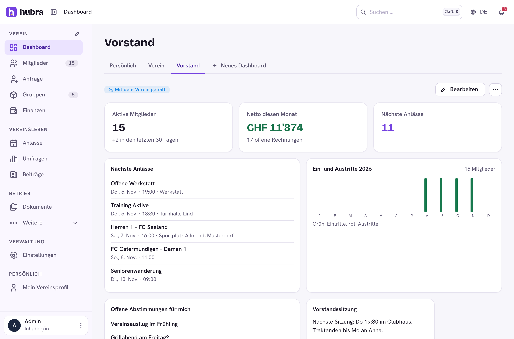
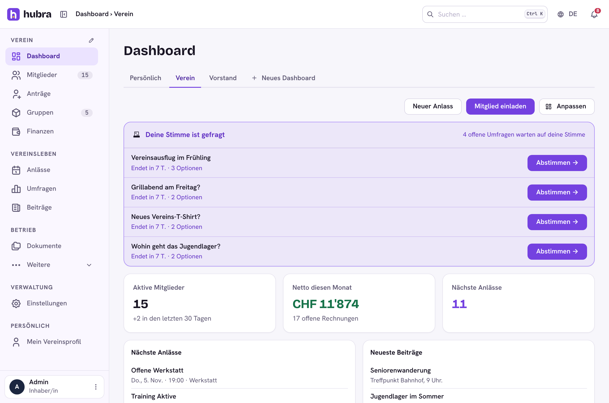
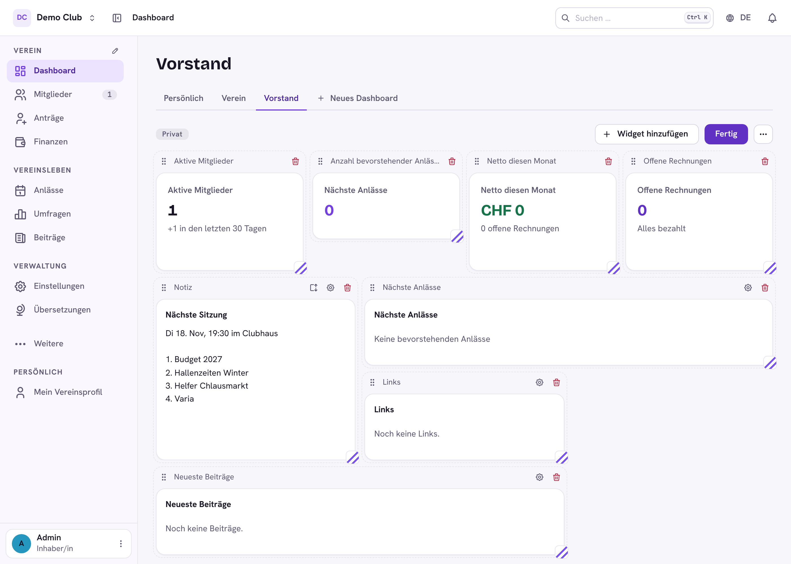

# Own dashboards

Next to **Dashboard › Persönlich** and **Dashboard › Verein**, every member can
put together their own dashboards from widgets: the board looks at members,
finances and the next events, a trainer at the next trainings and a few
links. **+ Neues Dashboard** creates one (at most 20 per member, 24 widgets
each). The module is `dashboards`, on by default.



## Start pages

**Persönlich** and **Verein** are widget pages too. Until someone changes
them they show the built-in layout:

* **Verein**: polls waiting for the member's vote, active members, this
  month's net and the number of upcoming events, numbers from plugins, the
  next events and the latest posts. **Neuer Anlass** and **Mitglied
  einladen** stay above it for who may use them.
* **Persönlich**: open payments, the member's numbers, their events, their
  votes, their attendance, their groups and cards from plugins.

A widget with nothing to show right now (no open payment, no poll to vote
in) takes no room.

**Anpassen** works like editing a dashboard. Every member changes their own
**Persönlich** page; only they see the change. The **Verein** page is the
same for everyone and needs the permission **Startseite des Vereins
anpassen** (`dashboards.home.update`); every member still sees only the
widgets their rights allow. `⋯ › Standard wiederherstellen` goes back to the
built-in layout. A changed club start page belongs to whoever saved it last:
if that member is deleted, the club gets the built-in layout back.



## Building one

Widgets sit on a grid of 12 columns and 40 px rows, like tiles. **Bearbeiten**
turns on edit mode, which shows the columns:

* **Widget hinzufügen** opens the widget list. A widget with settings asks
  for them before it is added; the cog changes them later.
* Drag the **grip** (⠿, left of the widget's name) onto another widget to
  move it there. Focused, the arrow keys move it one place.
* Drag the **corner** (bottom right) to change the width in columns (2 to 12)
  and the height in rows (1 to 24). Focused, ←/→ change the width and ↑/↓
  the height. A widget without a set height is as tall as its content; once
  it has one it keeps it and scrolls inside. **Höhe nach Inhalt** (the icon
  next to the cog) goes back to the content's height.
* The bin removes it.

Widgets fill the grid in their order, and a later small widget moves up into
a gap a wide one left. On a tablet a widget up to 4 columns wide takes half
the row and a wider one the whole row (the corner then only changes the
height); on a phone every widget takes the whole row.

**Fertig** leaves edit mode; every change is saved as it is made. The `⋯`
menu opens **Name und Sichtbarkeit** (rename and who sees it) or deletes
the dashboard.



## Widgets

| Widget | Shows | Needs |
| --- | --- | --- |
| Aktive Mitglieder | active members, joins in the last 30 days | module members |
| Anzahl bevorstehender Anlässe | how many events are ahead | module events |
| Netto diesen Monat | income less expenses this month, open invoices | module finance, `finance.invoices.read` |
| Nächste Anlässe | the next events (title, count, only my sign-ups) | module events |
| Neueste Beiträge | the latest posts (title, count) | module posts |
| Offene Abstimmungen für mich | polls the viewer can still vote in (title, count) | module polls |
| Ein- und Austritte | joins and leaves per month of this year (title) | module members, `members.members.read` |
| Notiz | a text of the owner's | nothing |
| Offene Rechnungen | how many of the club's invoices are open | module finance, `finance.invoices.read` |
| Deine Stimme ist gefragt | open polls the member hasn't voted in; nothing when there are none | module polls |
| Offene Zahlung, Meine Zahlen, Meine Anlässe, Meine Abstimmungen, Meine Präsenz, Meine Gruppen | the member's own invoices, numbers, events, votes, attendance and groups | events, polls or groups for the last four |
| Zahlen aus Plugins, Karten aus Plugins | what plugins put into the slots `dashboard.stats` and `account.cards` | nothing |
| Links | a list of links, one `Label \| https://…` per line (http and https only) | nothing |

Widgets load their data through the usual API routes, with the viewer's own
rights. A widget the viewer may not see (module off, or a permission missing)
is left out of the dashboard; in edit mode the owner sees a placeholder for
it so it can be removed.

## Private and shared

A new dashboard is private: only its owner sees it. **Wer sieht es** in the
create form and in `⋯` › Name und Sichtbarkeit offers **Privat**, **Ganzer
Verein** or **Gruppen** (one or more groups). Sharing needs the permission
**Dashboards mit dem Verein teilen** (`dashboards.dashboards.share`, Rollen ›
Berechtigungen); without it the form shows only the name. A dashboard shared
with the club shows up as a tab for every member; one shared with groups only
for their members (and its owner and admins). Each viewer sees only the
widgets their own rights allow, so sharing a board dashboard doesn't show
finances to members without finance rights.

Only the owner changes, shares or deletes a dashboard. A club admin can also
change, stop sharing or delete any dashboard (to tidy up), but can't share
someone else's private one, and their tab list shows only their own and the
shared ones. Changes to a shared dashboard are written to the audit log.

## API

`/api/v1/app/dashboards`, signed in as a member:

| Call | Does |
| --- | --- |
| `GET /` | `{items, canShare, max}`: the member's own and the ones shared with the club or one of the member's groups |
| `POST /` | `{name, widgets?}`, a new private dashboard (`409 LIMIT_REACHED` past the limit) |
| `GET /<id>` | one, if it is the member's own or shared |
| `PATCH /<id>` | `{name?, widgets?}` (owner or admin) |
| `PUT /<id>/sharing` | `{shared: bool, groupIds?: [id]}`: no or empty `groupIds` = the whole club (owner with the share permission; an admin may unshare any). Dashboards carry `groups: [{id, name}]` |
| `DELETE /<id>` | remove it (owner or admin) |
| `GET /home` | the start pages: `{club: {widgets, updatedAt, canEdit}, me: {…}}`; `widgets` is `null` while the built-in layout shows |
| `PUT /home/club` | `{widgets}`, needs `dashboards.home.update` |
| `DELETE /home/club` | back to the built-in layout (same right) |
| `PUT /home/me` / `DELETE /home/me` | the member's own start page |

A dashboard is `{id, name, shared, widgets, owner: {id, name}, mine, canEdit,
updatedAt}`. A widget is `{id, type, size, w?, h?, config}`: `id` is unique on the
dashboard (`[A-Za-z0-9_-]`, up to 40), `type` names the widget (letters,
digits and `_.:-`, up to 80), `w` the columns it spans (2 to 12), `h` its
height in rows (1 to 24; missing: as tall as its content), `size` (`s`, `m`
or `l`) the width before the grid, which the app still sends (and the server
fills from `w` when it is missing) so older apps keep working; a widget
without `w` is 4, 6 or 12 columns wide by its `size`. `config` is an object of at most
4000 characters as JSON. The server doesn't check that a type exists, so a
widget of a plugin that was removed stays saved and comes back with it.

## Widgets offered as contracts

A module or plugin can offer a widget from its backend manifest, as a
contract (docs/contracts.md). Core then decides who sees it and reads its
data: the widget list (`GET /widgets`) holds only widgets whose module is on
for the club and whose permission the member has, and the data
(`POST /widgets/<name>/data`) is read by the widget's handler as the viewing
member, with any writes rolled back. Such a widget is stored as type
`w:<name>`.

```python
from hubra.core.contracts import WidgetField, widget_contract

module = Module(
    code="inventory",
    ...,
    provides=(
        widget_contract(
            "inventory.lent",
            "hubra_inventory.widgets:lent",
            label="inventory.widget.lent",        # translation key or text
            description="inventory.widget.lentHint",
            size="m",                              # s, m or l
            view="list",                           # stat, list or custom
            perm="inventory.items.read",
            fields=(WidgetField("count", "inventory.widget.count", "number", 5),),
        ),
    ),
)


def lent(ctx, config):
    rows = ...  # the items lent out, newest first, at most config["count"]
    return {"items": [{"label": r.name, "sub": r.holder, "path": f"/app/inventory/{r.id}"}
                      for r in rows], "total": total}
```

`view="stat"` returns `{value, sub?, path?}` and the app draws a number tile;
`view="list"` returns `{items: [{label, sub?, path?}], total?}` and the app
draws rows. Neither needs any frontend code. `view="custom"` returns what
`output` describes and the plugin's frontend draws it: register a widget with
`contract: "inventory.lent"` and its component gets the data as `data`.

| Call | Does |
| --- | --- |
| `GET /widgets` | `{items: [{name, type, module, plugin, label, description, perm, size, view, fields}]}` |
| `POST /widgets/<name>/data` | `{config}` → `{data}`; `404` not offered or off, `403` right missing, `502` the handler broke |

## Widgets from plugins

A plugin's frontend adds widgets with `widgets` in `registerPlugin` (type
`PluginWidget` in `app/frontend/src/plugins/types.ts`):

```tsx
registerPlugin({
  id: 'inventory',
  widgets: [
    {
      id: 'lent',
      module: 'inventory',
      perm: 'inventory.items.read',
      label: 'inventory.widget.lent',
      description: 'inventory.widget.lentHint',
      size: 'm',
      fields: [{ key: 'count', label: 'inventory.widget.count', kind: 'number', default: 5 }],
      component: LentWidget, // ({ config, size }) => …
    },
  ],
})
```

The widget is stored as type `p:<plugin id>.<id>` (here `p:inventory.lent`).
`module` and `perm` decide who sees it, like a plugin's routes. `fields` are
the settings the member fills in (`text`, `number` or `switch`); the
component gets them as `config`, and `size` so it can show more when wide.
It renders inside an error boundary, so a failing widget doesn't break the
dashboard. Load data from the plugin's own API, never from another plugin.
A widget whose data the backend should check and read as the viewer is
better offered as a contract (above).
