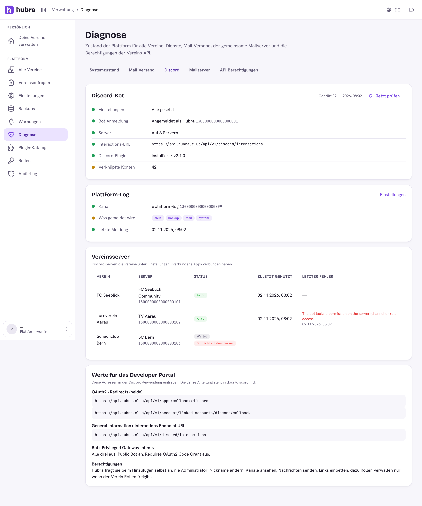
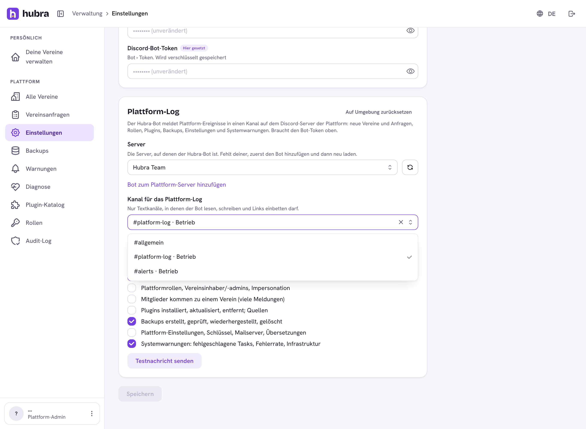
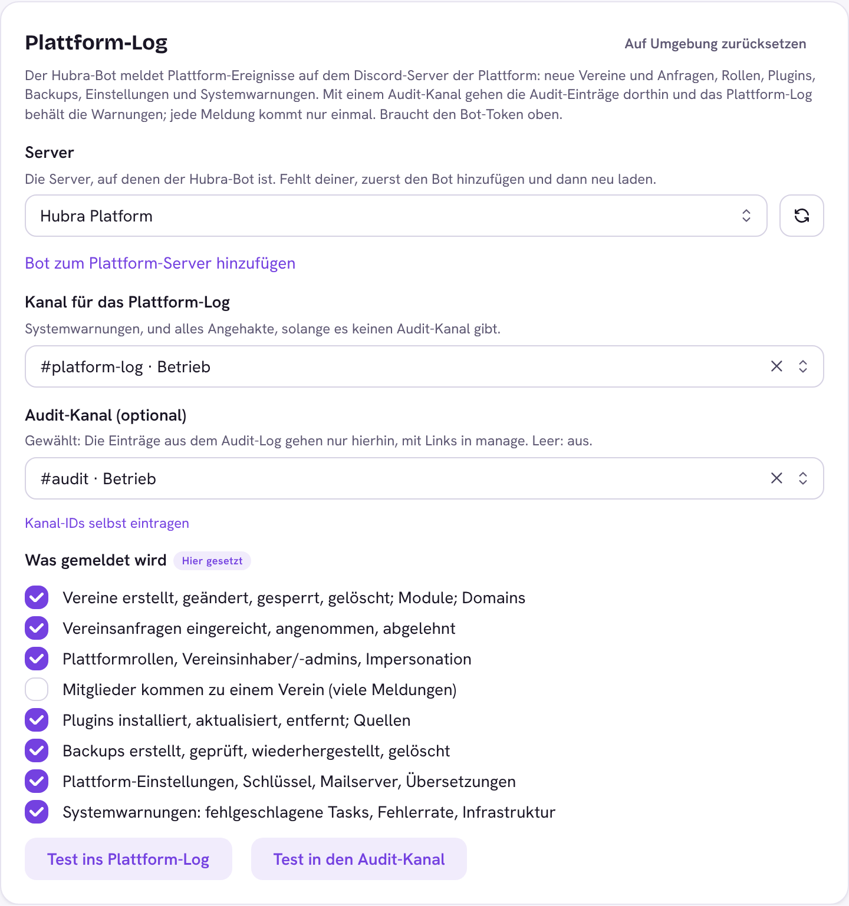
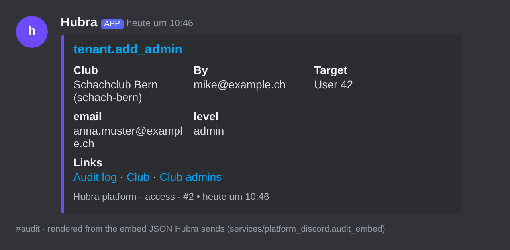
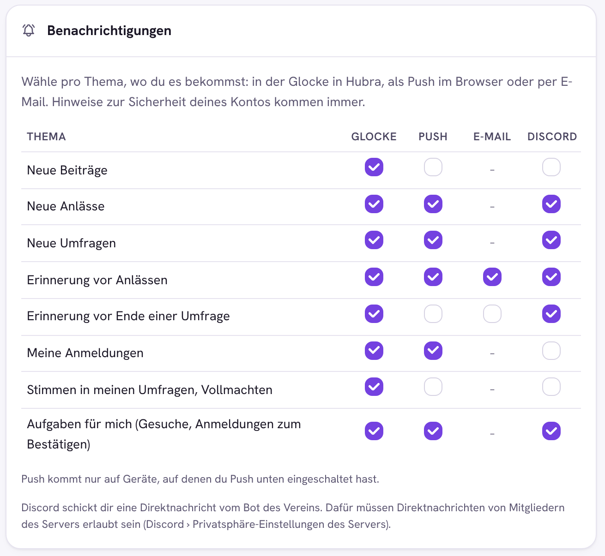

# Discord

Hubra has one Discord bot for every club on the platform. A club adds it to
its own Discord server under **Einstellungen › Verbundene Apps** (the
`discord` plugin must be installed and switched on). Members link their own
Discord account on the SSO account page (**Mein Konto › Verknüpfungen**), so
the bot can recognise them.

The credentials are platform settings (manage › Discord ›
Setup), stored encrypted with the platform's data key. Clubs never see or
paste a token; what Hubra stores per club is only the link (Discord server id,
channel, role mapping).

## Set up the Discord application (once per platform)

One Discord application serves every club. Below, `https://api.hubra.club`
stands for your API address (`API_PUBLIC_URL`). manage › Alerts ›
Discord shows the exact addresses for your instance under **Values for the
Developer Portal**.

### 1. Create the application

Open <https://discord.com/developers/applications>, click **New
Application**, name it **Hubra** and give it the Hubra logo.

### 2. Copy four values into Hubra

| Developer Portal | Hubra field (manage › Discord › Setup) |
| --- | --- |
| General Information › **Application ID** | Discord application ID |
| General Information › **Public Key** | Discord public key |
| OAuth2 › **Client Secret** (click *Reset Secret*) | Discord client secret |
| Bot › **Token** (click *Reset Token*) | Discord bot token |

Save in manage. The values take effect at once, with no restart. The secret
and the token are stored encrypted and never shown again; only platform
managers can change them.

### 3. Redirect URIs (OAuth2 › Redirects)

Add **both**. They must match character for character, including
`https` and with no trailing slash:

| Redirect | Used when |
| --- | --- |
| `https://api.hubra.club/api/v1/apps/callback/discord` | a club admin adds the bot to the club's server (Einstellungen › Verbundene Apps) |
| `https://api.hubra.club/api/v1/account/linked-accounts/discord/callback` | a member links their Discord account (Mein Konto › Verknüpfungen) |

If one is missing, Discord shows "Invalid OAuth2 redirect_uri" at that step.

### 4. Bot settings (Bot page)

| Setting | Value | Why |
| --- | --- | --- |
| Public Bot | **on** | otherwise only you could add it, and no club could |
| Requires OAuth2 Code Grant | **off** | Hubra adds the bot with its own OAuth flow |
| Presence Intent | **off** | not needed |
| Server Members Intent | **on** | the gateway process hears when someone joins a club's server (welcome message, roles on joining); without it the rest still works |
| Message Content Intent | **off** | the bot never reads messages |

On the **Installation** page set *Install Link* to **None** and leave
only **Guild Install** ticked: clubs add the bot through Hubra's own link,
which carries the club and the permissions it allowed.

Ready-made assets: a full-bleed app icon (Discord crops it to a circle) and
a banner can be rendered from `brand/hubra-mark.svg` and
`brand/hubra-wordmark-white.svg`; suggested description: "The Hubra bot for
your club: new events, posts and polls in your channels, reminders, sign-ups
with /events, and Discord roles that follow your groups. Connect it in Hubra
under Einstellungen › Verbundene Apps."

The bot answers over HTTP (step 5) and calls the REST API for everything
except "someone joined the server". Only that needs a gateway connection,
kept by one small process for the whole platform (step 8). Without that
process the bot shows as "offline" in Discord, and that is normal.

### 5. Interactions Endpoint URL

General Information › **Interactions Endpoint URL**:
`https://api.hubra.club/api/v1/discord/interactions`

Discord sends a signed test request when you save, so the backend must be
up, the Discord plugin installed, and the public key from step 2 saved in
Hubra first. Slash commands and buttons arrive here.

### 5b. Linked Roles Verification URL

General Information › **Linked Roles Verification URL**:
`https://<SSO address>/account/verknuepfungen?link=discord` (manage ›
Discord › Status shows the exact address).

Discord sends someone there when they pick a Hubra linked role in a server's
settings. The page starts the account link, which also asks for
`role_connections.write`. Hubra then tells Discord three values for that
person: *Member of a club on Hubra*, *Clubs* (how many) and *Member for
(days)*. A server owner uses them under Server Settings › Roles › Links.

Linked Roles are per person and per application, not per server. They can
say "is an active member of a club on Hubra", not "is a member of this
club". For "member of this club", the club maps a role under
Verbundene Apps (role sync). Hubra registers the three values with Discord
on the first push and refreshes everyone's values nightly at 04:10.

### 6. Permissions

You don't tick permissions in the portal. Hubra asks for them in the link
it builds when a server adds the bot, and only for what the club allowed.
It never asks for Administrator.

| Server | OAuth2 scopes | Permissions | When |
| --- | --- | --- | --- |
| A club's server | `bot`, `applications.commands` | Change Nickname | always (the bot takes the club's name) |
| | | View Channels, Send Messages, Embed Links | the club allows "announce" or "commands" |
| | | Manage Roles | the club allows "roles" |
| | | Create Events | the club allows "events" (Discord events) |
| | | Manage Channels, Manage Roles, View Channels, Send Messages, Embed Links, Read Message History | the club allows "channels" (group channels) |
| The platform's own server (platform log) | `bot` | View Channels, Send Messages, Embed Links (`19456`) | always |
| Member account link | `identify`, `role_connections.write` | none | a member links their account (the second scope is for Linked Roles; a member may decline it) |

On a club's server the bot shows the club's name, logo and a short bio
(plugin 2.1+, per server, so other servers still see Hubra). The app's own
name, icon and description in the Developer Portal are what every other
place shows: give it the Hubra mark (square PNG, 512 px or more) and a line
such as "The Hubra bot for your club: events, posts, polls, reminders,
sign-ups and roles that follow your groups."

Manage Roles only works on roles **below the bot's own role** in the server's
role list. Drag the Hubra role above the roles the club maps.

When a club turns on a scope later (for example group channels), the bot's
role on that server lacks the new permission. The club's Discord settings
then say which permissions are missing and link to **Bot erneut
hinzufügen**: adding the bot again to the same server updates its role.

### 7. Check it

Open manage › **Discord › Status** and click **Check now**. It shows:

- whether the bot token signs in, and as which bot;
- how many servers the bot is on;
- whether the Interactions Endpoint URL matches;
- the platform log channel and its last post;
- every club server and its last error.

A failing check also shows on manage › Alerts.

Without the application ID and bot token, the Discord app shows as "not set
up on this platform" to clubs, and nothing else changes.

### 8. Gateway process (welcome message)

The welcome message for new people on a club's server, and roles for a
linked member the moment they join, need the gateway. It is one process for
the whole platform, from the backend image:

- Docker Compose: `docker compose --profile discord up -d discord-gateway`
- k3s: the Deployment `discord-gateway` in `deploy/app` (1 replica; keep it
  at one, Discord would otherwise send each join twice)

It runs `flask modules run discord-gateway`. While the plugin isn't
installed or the bot token isn't saved, it waits and checks again every ten
minutes. If Discord refuses the Server Members intent (step 4) it logs that
and waits too. Everything else works without this process.

### Troubleshooting

| You see | Fix |
| --- | --- |
| "Invalid OAuth2 redirect_uri" | add the exact redirect from step 3 |
| Bot sign-in: Discord refused the bot token (401) | reset the token in the portal and save the new one in Hubra |
| Interactions URL can't be saved in the portal | the backend is unreachable, the plugin is not installed, or the public key in Hubra is wrong |
| "Bot not on server" for a club | someone removed the bot; the club connects it again under Verbundene Apps |
| Roles don't change | move the Hubra role above the mapped roles; check the club allowed "roles" |
| Welcome message never arrives | run the gateway (step 8), turn on Server Members Intent, and check the club turned on the welcome and the "notify" scope; the person may not allow direct messages from server members |
| A Hubra linked role can't be picked | set the Linked Roles Verification URL (step 5b); the member links again and allows "role connections" |
| Club settings say permissions are missing | the club uses **Bot erneut hinzufügen** there |
| Platform log: the bot cannot see the channel | add the bot to the platform server (link in Discord › Setup) and allow it to view the channel |

## Platform log (the platform's own server)

The same bot can post platform events to a channel on the platform's own
Discord server. Set it up in manage › Discord › Setup ›
Platform log:

1. Click **Add the bot to the platform server** (it asks only for View
   Channels, Send Messages and Embed Links) and pick your server.
2. Back in Hubra, click the reload button next to **Server**, pick your
   server, then pick the **channel**. The list only has text channels the bot
   may view, send and embed links in. Save.

   Fallback (Discord unreachable, or a channel the bot doesn't see yet):
   **Enter the channel ID yourself**. Turn on Developer Mode in Discord (User
   Settings › Advanced), right-click the channel › **Copy Channel ID** and
   paste it.
3. Click **Test the platform log**. What is posted where is chosen in
   manage › Alerts › **Notifications**: one matrix with the platform events
   (the categories below) and the alert types as rows and Mail / Discord as
   columns. Mail goes to the platform admins (superadmins and
   `platform.settings` holders); a ticked platform event mails each of them
   with a link to the entry (`notify.mail_events`, off by default).

### Audit channel (optional)

The platform log card has one **Server** picker and two channel pickers on
that server: the **platform log** and an optional **audit channel**
(`discord.audit_channel_id`). Without an audit channel, everything ticked
goes to the platform log. With one, the audit log entries go to the audit
channel only and the platform log keeps the system alerts, so nothing is
posted twice. The categories decide what is posted either way.

Each post links back to manage when the manage address is set (Platform
settings › Alerts): the title opens the entry in the audit log
(`/app/audit?entry=<id>`, with its details), and a **Links** field points at
the club and the page the change belongs to (club admins, club requests,
roles, support access, plugins, backups or platform settings). These links
also appear in platform log posts.

Categories:

| Category | What |
| --- | --- |
| clubs | Club created, changed, suspended, deleted; modules turned on or off; custom domains unverified or expired |
| requests | Club requests submitted, approved, rejected |
| access | Platform roles, club owners and admins added or removed, impersonation |
| members | Members added to a club or accepting an invite (off by default: one post per member) |
| plugins | Plugins installed, updated, rolled back, removed; plugin repositories |
| backups | Backups created, verified, restored, deleted |
| platform | Platform settings, encryption keys, mail server, translations |
| alerts | System alerts: failed Celery tasks, API error rate, disk/Redis/Postgres checks, with buttons (below) |
| digest | Daily overview at 08:00 (`MAIL_TIMEZONE`, default Europe/Zurich): new clubs, new accounts, open club requests, mail sent/fallback/failed, open problems, slow endpoints, plugin updates |
| releases | Once per version, when a new Hubra version runs: its release notes (German) |
| security | Platform admins signing in on a new device or losing their two-factor sign-in, 20 failed sign-ins from one IP address within 10 minutes, encryption keys older than a year (once a month) |

Every platform audit entry (`global_audit_logs`) is posted after its change
is committed, by a Celery task, with the club, who did it, the target and the
entry's details. Values whose key looks like a secret (password, token, key,
secret, code) are shown as `***`. Alerts replace the old
`DISCORD_WEBHOOK_URL` setting, which is gone.

Installs that saved their categories before digest, releases and security
existed keep their list: tick the new ones in manage › Platform settings ›
Discord.

### Platform admins in Discord

On the platform server the bot also takes clicks and commands from platform
admins. Whoever clicks must have linked their Discord account to their Hubra
account (SSO › Konto › Verknüpfungen), that account needs two-factor sign-in
(an app or a passkey), and it needs the same platform permission as in
manage. Anyone else gets a private "not allowed" answer.

| Where | What | Permission |
| --- | --- | --- |
| Club request message | **Annehmen** sets the club up (in a background job; the answer follows), **Ablehnen** asks for a reason that goes to the requester. Decided requests show the outcome and lose their buttons, also when decided in manage. | `requests.approve` |
| Alert message | **Bestätigen** notes who saw it. **1 h stumm** silences that alert type (mail and Discord) for an hour. **In manage öffnen** links to manage › Alerts (set `alerts.manage_url`). When the problem behind a relay, service, backup or mail alert is gone, the message turns green with "Behoben". | `platform.diagnostics` / `platform.settings` |
| `/plattform status` | Version, active clubs, maintenance, open problems, silenced alert types | `platform.diagnostics` |
| `/plattform verein <name>` | One club's health: members, last activity, storage, mail, plugins, warnings (name or slug, with suggestions) | `tenants.read` |
| `/plattform backup [verein]` | Start a backup of the platform or one club | superadmin (`backups.manage`) |
| `/wartung jetzt [minuten] [text]` | Maintenance mode on now | `platform.settings` |
| `/wartung planen <start> <minuten> [text]` | Announce maintenance (`22:00`, `2026-11-05 22:00` or `05.11.2026 22:00`, platform time zone) as a planned window for every club (manage › Alerts › Geplante Wartungen). The club apps show the notice from 24 hours before; it starts and ends by itself. `abbrechen` cancels the next one. | `platform.settings` |
| `/wartung ende`, `/wartung abbrechen` | End maintenance; cancel a planned one | `platform.settings` |

The commands are installed on the platform server only (the server of the
log channel), within a minute of setting the channel, and are shown to
members with "Manage Server" by default (Server Settings › Integrations ›
Hubra can narrow that further). Discord interactions keep working
during maintenance so `/wartung ende` does; club commands answer that Hubra
is being updated.

Clubs can opt in to hear about it on their own server (Settings › Verbundene
Apps › Discord: **Neue Hubra-Versionen ankündigen**, **Wartungen
ankündigen**, both off by default): new versions with their main changes,
and planned, started, ended or cancelled maintenance, in the main channel.

### Roles on the platform server

manage › Platform settings › Discord › **Rollen auf dem Plattform-Server**
(`discord.platform_roles`, off by default). When on, the bot gives everyone
who linked their Discord account these roles on the platform log's server:

| Role | Who |
| --- | --- |
| Plattform-Admin | Platform staff (superadmin or a global role) with two-factor, the same people the buttons above accept |
| Vereinsinhaber | Owner of at least one active club |
| Vereinsadmin | Admin, not owner, of at least one active club |
| Vereinsmitglied | Active member of at least one club |

- The bot makes the roles itself with **no permissions**, not mentionable.
  What they may see is up to you (channel permissions on Discord). An
  existing role with the same name is only taken over when it has no
  permissions either.
- It only gives or takes these four roles, never one a person made, and
  only for people who linked Discord. Disabled accounts, people who turn off
  two-factor (Plattform-Admin) or leave their clubs, and people who unlink
  lose them.
- Updated every ten minutes (only people whose roles should change cost a
  Discord call), right after someone links Discord, when someone joins the
  server (with the gateway process running), and in full once a day.
- Turning it off deletes the four roles.
- The bot needs **Manage Roles** on the platform server, and its own role
  must be above these roles (it is, for roles it made itself).

## What the bot may do on a club's server

The club picks scopes when it adds the bot; each asks only for the
permissions it needs (table in step 6), never Administrator.

| Scope | What it does |
| --- | --- |
| announce | new events, posts, polls and reminders in the club's channels |
| roles | Discord roles that follow groups, functions, tiers or "all members" |
| commands | sign-up and vote buttons, `/events`, `/rechnungen`, `/trainings` (with check-in), `/profil` |
| events | the club's events in the server's Events list (next 60 days, kept in step) |
| channels | a private channel and role per group the club picks; the group's events and polls go there |
| notify | direct messages: notifications members ask for, and a welcome for new people |

Manage Roles only works on roles below the bot's own role, and Hubra only
changes roles the club mapped or made for group channels.

## Notifications by Discord

With the "notify" scope on a club's server, members who linked their Discord
account see a **Discord** column in Mein Konto › Benachrichtigungen and turn
it on per topic (off by default). The bot sends those notifications as
direct messages, in the member's language, with the club's name and colour.
Discord only delivers them if the person shares a server with the bot and
allows direct messages from that server's members.

