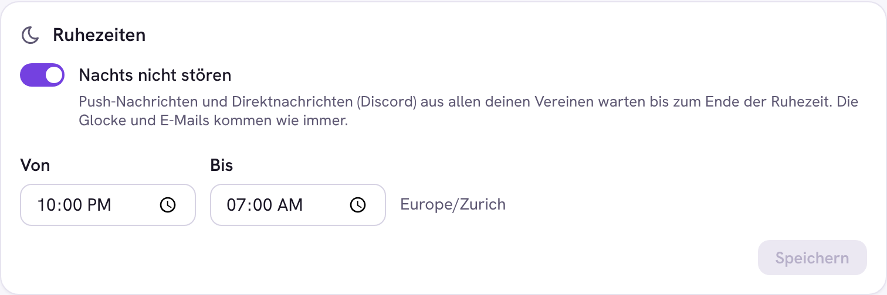

# Notifications

How a member hears about something in a club, and what they choose.

## Channels

| Channel | Where | Chosen |
| --- | --- | --- |
| Bell | the club app and the account page (all clubs) | per topic, in the club (Konto › Mitgliedschaft › Benachrichtigungen) |
| Browser push | every browser the person turned push on in | per topic, in the club |
| Mail | reminders and the weekly digest | per topic, in the club |
| Connected app (Discord direct message) | the account linked there | per topic, off until turned on; `hubra/core/notifications/channels.py` |

Topics, defaults and the stored choices: `hubra/core/notifications/prefs.py`.
A plugin adds a channel by giving its connected app a
`deliver_notification` hook (see `channels.py`); the member then sees it as
one more column.

## Quiet hours

On SSO › Mein Konto › Benachrichtigungen › Einstellungen a person sets
quiet hours ("Nachts nicht stören", for example 22:00 to 07:00 in their
time zone). They count for every club. A browser push or a direct message
through a connected app that falls into them waits and goes out when they
end, once; the bell and mails are not held.

- Stored in `users.quiet_hours` (`{"from", "to", "tz"}`),
  `hubra/core/notifications/quiet.py`.
- API: `GET` and `PUT /api/v1/global/account/quiet-hours` with
  `{"quiet": {...} | null}`.
- The push task (`push_tasks.send_push_task`) and the app channel task
  (`connected_app_tasks.deliver_app_notification`) check the window when they
  run and queue themselves again with a countdown to its end.

